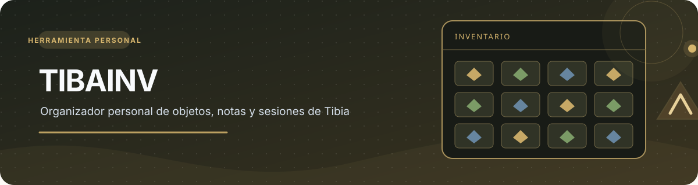
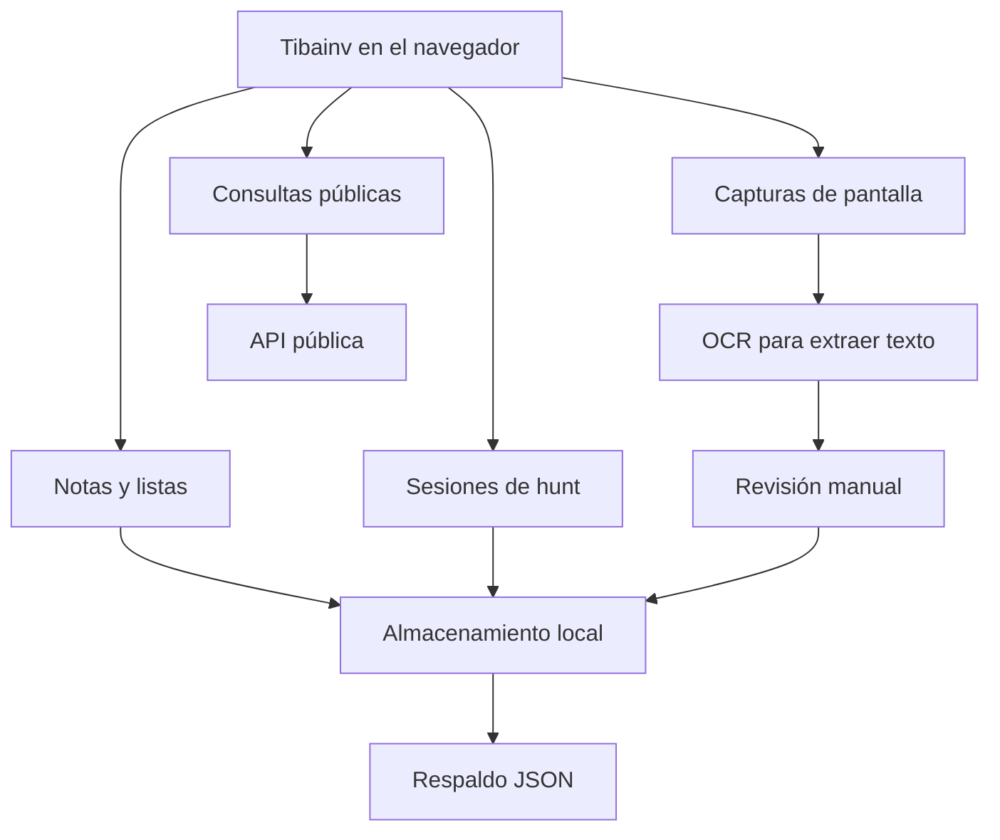

  

  
  
  
  
  

<h1 align="center">Tibainv</h1>

Un pequeño centro para guardar notas, listas, capturas y datos de Tibia.

  <a href="#mapa-del-proyecto">Mapa del proyecto</a> ·
  <a href="#herramientas">Herramientas</a> ·
  <a href="#capturas-y-ocr">Capturas y OCR</a> ·
  <a href="#límites-actuales">Límites</a>

Tibainv es una herramienta que estoy haciendo para organizar información de Tibia. La idea es tener en un solo lugar mis notas, listas, capturas y algunos datos públicos del juego.

Es un proyecto personal y todavía tiene funciones en pruebas. No se conecta a la cuenta del juego ni necesita la contraseña de Tibia.

## Mapa del proyecto

## Qué tiene

| Herramienta | Uso |
|---|---|
| Búsqueda | Consultar información pública de personajes, objetos y criaturas |
| Notas y listas | Guardar información propia |
| Sesiones | Registrar manualmente hunts y cantidades |
| Capturas | Importar imágenes del juego |
| OCR | Intentar leer texto de una captura |
| Respaldos | Importar y exportar JSON |

## Cómo abrirlo

Abre `index.html` en un navegador. Si algunas peticiones externas no funcionan al abrir el archivo directamente, puedes usar un servidor local o publicar la página en un hosting estático.

## Capturas y OCR

1. Guarda una captura desde Tibia.
2. En Tibainv, abre la sección de capturas y selecciona la imagen.
3. Usa la opción para leer el texto.
4. Revisa el resultado y corrige lo que esté mal antes de guardarlo.

> El OCR puede confundir letras y números. Revisa el texto antes de guardarlo como un dato correcto.

## Dónde se guardan los datos

La información personal se guarda en el navegador. Las imágenes se manejan con IndexedDB. Las consultas de personajes y criaturas usan un servicio público externo, por lo que pueden tardar o dejar de funcionar.

## Límites actuales

- No lee el inventario en vivo.
- No detecta automáticamente los objetos por sus iconos.
- No cuenta las criaturas eliminadas por sí solo.
- No lee la memoria del cliente ni intercepta el tráfico del juego.

## Tecnologías y herramientas

HTML, CSS, JavaScript, IndexedDB, APIs públicas y Tesseract.js para OCR. También hay pruebas automatizadas con GitHub Actions.

Proyecto personal · No solicita credenciales ni se conecta a la cuenta del juego.

